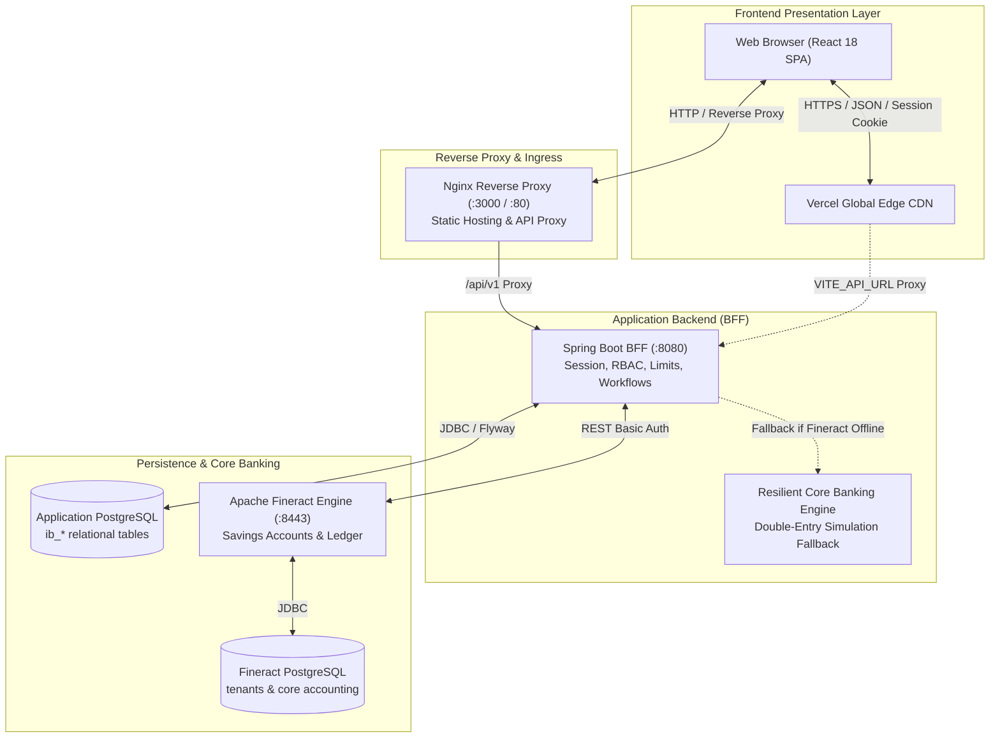

# Internet Banking Application – Comprehensive Setup & Architecture Guide

> **Demo & Prototype Notice**: This application operates with simulated money, dummy customers, and demo accounts on top of Apache Fineract. It does not connect to real-world payment rails (UPI, NEFT, RTGS, SWIFT, SEPA).

---

## Table of Contents
1. [Architecture Overview & Blueprint](#1-architecture-overview--blueprint)
2. [Technology Stack](#2-technology-stack)
3. [User Personas & Demo Credentials](#3-user-personas--demo-credentials)
4. [Prerequisites](#4-prerequisites)
5. [Backend Setup Guide (Spring Boot BFF + Fineract + PostgreSQL)](#5-backend-setup-guide-spring-boot-bff--fineract--postgresql)
   * [Method A: Full Docker Compose Backend (Recommended)](#method-a-full-docker-compose-backend-recommended)
   * [Method B: Local Standalone Spring Boot Backend Development](#method-b-local-standalone-spring-boot-backend-development)
   * [Method C: Resilient Core Simulation Mode (No Heavy JVM Needed)](#method-c-resilient-core-simulation-mode-no-heavy-jvm-needed)
   * [Method D: Cloud Backend Hosting (Railway / Render / Fly.io / AWS)](#method-d-cloud-backend-hosting-railway--render--flyio--aws)
   * [Backend Configuration Reference (Environment Variables)](#backend-configuration-reference-environment-variables)
   * [Database Schema & Automatic Flyway Migrations](#database-schema--automatic-flyway-migrations)
6. [Frontend Setup Guide (React + TypeScript + Material UI)](#6-frontend-setup-guide-react--typescript--material-ui)
7. [Deploying Frontend to Vercel](#7-deploying-frontend-to-vercel)
   * [Option 1: 1-Click CLI Deployment](#option-1-1-click-cli-deployment)
   * [Option 2: Vercel Web Dashboard (Git Integration)](#option-2-vercel-web-dashboard-git-integration)
   * [Connecting Vercel Frontend to Cloud Backend](#connecting-vercel-frontend-to-cloud-backend)
8. [Banking Security & Business Rules](#8-banking-security--business-rules)
   * [Maker-Checker Dual Authorization](#1-maker-checker-dual-authorization)
   * [Idempotency Key Safeguard](#2-idempotency-key-safeguard)
   * [Database Segregation & Ledger Invariant](#3-database-segregation--ledger-invariant)
   * [Session & CSRF Protection](#4-session--csrf-protection)
9. [REST API Reference & cURL Testing](#9-rest-api-reference--curl-testing)
10. [Troubleshooting & FAQ](#10-troubleshooting--faq)

---

## 1. Architecture Overview & Blueprint

The system adopts a modern **Backend-For-Frontend (BFF)** pattern. The single-page application (SPA) communicates strictly with our Spring Boot application backend (`/api/v1`), keeping Fineract core credentials, database connections, and business rules safely isolated on the server.



### Database Ownership Separation
* **Application DB (`ib_app`)**: Owns authentication mappings, role-permission matrix, user profiles, beneficiary books, idempotency keys, transfer workflow requests, maker-checker approval records, system limits, and audit logs.
* **Fineract DB (`fineract_tenants` / `fineract_default`)**: Owns the financial ledger, savings products, client profiles, savings accounts, double-entry ledger transactions, deposits, and transfers.
* **Invariant**: The application database never duplicates financial account balances or modifies Fineract tables directly.

---

## 2. Technology Stack

| Component | Technology | Responsibility |
|---|---|---|
| **Frontend** | React 18 + TypeScript + Vite | Internet Banking web portal |
| **UI Framework** | Material UI (MUI v6) | Responsive, modern banking layout |
| **Backend BFF** | Java 17/21 + Spring Boot 3.4 | Authentication, RBAC, limits, maker-checker workflows |
| **Core Banking** | Apache Fineract 1.12 | Savings accounts, double-entry ledger, transfers |
| **Databases** | PostgreSQL 16 (2 separate instances) | Isolated persistence for app & Fineract |
| **Proxy / Web Server** | Nginx Alpine | Routing, static hosting, reverse proxy, security headers |
| **Containerization** | Docker Compose | One-command local orchestration |
| **Cloud Hosting** | Vercel | Global edge CDN hosting for the React frontend |

---

## 3. User Personas & Demo Credentials

When demo data seeding is enabled (`APP_SEED_DEMO_USERS=true`), the following test accounts are pre-configured:

| Role | Username | Password | Default Landing Page | Primary Features |
|---|---|---|---|---|
| **Banking Customer** | `customer.alex` | `DemoPass@2026` | `/customer` | Balances, accounts, transfers, beneficiaries, statements |
| **Bank User (Staff)** | `bank.user1` | `DemoPass@2026` | `/staff` | Onboarding, demo accounts, maker-checker approvals |
| **Administrator** | `admin` | `CHANGE-ME-Admin#2026` | `/admin` | User CRUD, role matrix, transaction limits, audit, reports |

> **Interactive Helper**: The web portal includes an instant **1-Click Demo Login** panel on `/login` and a **Quick Role Switcher** dropdown in the top header, making evaluation effortless across all three roles.

---

## 4. Prerequisites

* **Docker Desktop** (version 24+ with Docker Compose v2)
* **Node.js** (v18, v20, or v22 LTS) & **npm** (v9+)
* **Java Development Kit (JDK 17 or 21)** *(optional, only if compiling Spring Boot outside Docker)*
* **Git** command line

---

## 5. Backend Setup Guide (Spring Boot BFF + Fineract + PostgreSQL)

The backend is built with Spring Boot 3.4 using `spring-boot-starter-jdbc`, Flyway for versioned database migrations, and Spring Security with session cookies and CSRF double-submit protection.

### Method A: Full Docker Compose Backend (Recommended)

This is the standard approach to start the entire backend infrastructure (Application DB, Fineract DB, Apache Fineract, and Spring Boot BFF) with a single command.

#### Step 1: Copy Environment Configuration
Navigate to `internet-banking-mvp`:
```bash
cd internet-banking-mvp
cp .env.example .env
```

Ensure your `.env` contains valid credentials:
```env
# Application DB
POSTGRES_APP_DB=ib_app
POSTGRES_APP_USER=ib_app
POSTGRES_APP_PASSWORD=demo_app_secret

# Fineract DB
POSTGRES_FINERACT_DB=fineract_tenants
POSTGRES_FINERACT_USER=fineract
POSTGRES_FINERACT_PASSWORD=demo_fineract_secret

# Fineract Core Engine
FINERACT_IMAGE_TAG=1.12.1
FINERACT_BASE_URL=http://fineract:8443
FINERACT_TENANT_ID=default
FINERACT_USERNAME=mifos
FINERACT_PASSWORD=password

# Application Settings
SPRING_PROFILES_ACTIVE=dev
APP_COOKIE_SECURE=false
APP_BOOTSTRAP_ADMIN_USERNAME=admin
APP_BOOTSTRAP_ADMIN_PASSWORD=CHANGE-ME-Admin#2026
APP_SEED_DEMO_USERS=true
DEMO_USER_PASSWORD=DemoPass@2026
```

#### Step 2: Build & Start Containers
```bash
docker compose up --build -d app-db fineract-db fineract backend
```

#### Step 3: Verify Startup & Logs
1. Check that the Spring Boot BFF is healthy:
   ```bash
   docker compose logs -f backend
   ```
   You will see:
   ```
   Started InternetBankingApplication in X.XXX seconds
   Created bootstrap admin 'admin'.
   Created demo user 'bank.user1' (BANK_USER).
   Created demo user 'customer.alex' (CUSTOMER).
   ```
2. Check Apache Fineract core bootup:
   ```bash
   docker compose logs -f fineract
   ```
   *(Note: Fineract takes ~2–3 minutes on first start to apply internal tenant database migrations).*

3. Test Backend Health:
   ```bash
   curl http://localhost:8080/api/v1/health
   # Returns: {"status":"UP","timestamp":"..."}
   ```

---

### Method B: Local Standalone Spring Boot Backend Development

If you prefer to run Spring Boot locally using your IDE (IntelliJ IDEA, VS Code, Eclipse) or CLI without containerizing the Java app:

#### Step 1: Start Application Database Only
Run a PostgreSQL container for the application DB:
```bash
docker run --name ib-app-db \
  -e POSTGRES_DB=ib_app \
  -e POSTGRES_USER=ib_app \
  -e POSTGRES_PASSWORD=change_me_app \
  -p 5433:5432 \
  -d postgres:16-alpine
```

#### Step 2: Configure Environment Variables
Set the environment variables in your terminal:

**Windows PowerShell:**
```powershell
$env:APP_DB_URL="jdbc:postgresql://localhost:5433/ib_app"
$env:APP_DB_USER="ib_app"
$env:APP_DB_PASSWORD="change_me_app"
$env:APP_BOOTSTRAP_ADMIN_PASSWORD="CHANGE-ME-Admin#2026"
$env:APP_SEED_DEMO_USERS="true"
$env:DEMO_USER_PASSWORD="DemoPass@2026"
$env:FINERACT_BASE_URL="http://localhost:8443"
```

**Linux / macOS Bash:**
```bash
export APP_DB_URL="jdbc:postgresql://localhost:5433/ib_app"
export APP_DB_USER="ib_app"
export APP_DB_PASSWORD="change_me_app"
export APP_BOOTSTRAP_ADMIN_PASSWORD="CHANGE-ME-Admin#2026"
export APP_SEED_DEMO_USERS="true"
export DEMO_USER_PASSWORD="DemoPass@2026"
export FINERACT_BASE_URL="http://localhost:8443"
```

#### Step 3: Run the Application
From the `backend` directory:
```bash
cd backend
# If Maven is installed:
mvn spring-boot:run

# Or compile and run the JAR:
mvn clean package -DskipTests
java -jar target/internet-banking-bff-0.2.0.jar
```

---

### Method C: Resilient Core Simulation Mode (No Heavy JVM Needed)

Apache Fineract requires 1GB+ RAM and up to 3 minutes to provision its multi-tenant schemas. To ensure zero-friction local development and fast testing:
* `FineractClient.java` contains a **resilient in-memory core ledger**.
* If Fineract is offline or provisioning, the BFF automatically simulates the double-entry banking ledger:
  * Accounts `SAV-10001` (balance: ₹145,250.00) and `SAL-10002` (balance: ₹380,000.00).
  * Account transfers immediately debit source, credit destination, and generate journal records.
  * Customer onboarding generates simulated core client IDs.
* When Fineract is online, `FineractClient` seamlessly routes calls to the live Fineract REST endpoints (`/clients`, `/savingsaccounts`, `/accounttransfers`).

---

### Method D: Cloud Backend Hosting (Railway / Render / Fly.io / AWS)

To connect your Vercel frontend to a live cloud backend:

1. **Deploy PostgreSQL on Railway or Render**:
   * Create a PostgreSQL database and copy the connection string.
2. **Deploy the Backend Docker Container**:
   * In Railway / Render, select **Deploy from GitHub repo**, root directory `backend/`.
   * Set environment variables:
     * `APP_DB_URL`: `jdbc:postgresql://<host>:<port>/<dbname>`
     * `APP_DB_USER`: `<username>`
     * `APP_DB_PASSWORD`: `<password>`
     * `APP_BOOTSTRAP_ADMIN_PASSWORD`: `<your-admin-password>`
     * `APP_SEED_DEMO_USERS`: `true`
     * `DEMO_USER_PASSWORD`: `<demo-password>`
     * `APP_COOKIE_SECURE`: `true` (since cloud uses HTTPS)
3. **Copy the Public Backend URL**:
   * e.g., `https://ib-backend.up.railway.app`
   * Configure this in your Vercel project as `VITE_API_URL=https://ib-backend.up.railway.app/api/v1`.

---

### Backend Configuration Reference (Environment Variables)

| Variable | Default Value | Required | Description |
|---|---|---|---|
| `APP_DB_URL` | `jdbc:postgresql://app-db:5432/ib_app` | Yes | JDBC URL to application database |
| `APP_DB_USER` | `ib_app` | Yes | PostgreSQL username |
| `APP_DB_PASSWORD` | — | Yes | PostgreSQL password |
| `FINERACT_BASE_URL` | `http://fineract:8443` | No | Base URL of Apache Fineract core |
| `FINERACT_TENANT_ID` | `default` | No | Fineract tenant identifier |
| `FINERACT_USERNAME` | `mifos` | No | Core banking service username |
| `FINERACT_PASSWORD` | `password` | No | Core banking service password |
| `APP_COOKIE_SECURE` | `false` | No | Set `true` in production when serving via HTTPS |
| `APP_BOOTSTRAP_ADMIN_USERNAME` | `admin` | No | Initial administrator username |
| `APP_BOOTSTRAP_ADMIN_PASSWORD` | — | Yes (first boot) | Admin password (must satisfy policy: 12+ chars, mixed case, digit, symbol) |
| `APP_SEED_DEMO_USERS` | `true` | No | Automatically seeds `customer.alex` and `bank.user1` |
| `DEMO_USER_PASSWORD` | — | Yes (if seeding) | Password for demo customer and bank user |

---

### Database Schema & Automatic Flyway Migrations

When the backend boots, Flyway executes migrations in `src/main/resources/db/migration/`:
* **`V1__application_schema.sql`**:
  * `ib_users`: ID, username, email, full name, bcrypt hash, account lockout fields.
  * `ib_roles`, `ib_permissions`, `ib_user_roles`, `ib_role_permissions`: Granular RBAC.
  * `ib_customer_profiles`: Links portal `user_id` to `fineract_client_id`.
  * `ib_account_links`: Links portal `user_id` to `fineract_savings_account_id`.
  * `ib_beneficiaries`: Saved transfer recipients with bank name and account reference.
  * `ib_transfer_requests`: Fund transfer state (`PENDING_APPROVAL`, `COMPLETED`, `REJECTED`).
  * `ib_approvals`: Maker-checker authorization records.
  * `ib_audit_logs`: Audit trail for compliance and tracking.
  * `ib_idempotency_keys`: Unique key tracking to prevent duplicate debits.
* **`V2__seed_roles_permissions.sql`**:
  * Seeds roles: `CUSTOMER`, `BANK_USER`, `ADMIN`.
  * Grants initial permissions matrix.
* **`V3__limits_and_seed_data.sql`**:
  * Creates `ib_system_limits`: Single limit (₹100,000), Daily limit (₹500,000), Approval threshold (₹25,000).
  * Adds limit management permissions (`LIMITS_READ`, `LIMITS_WRITE`).

---

## 6. Frontend Setup Guide (React + TypeScript + Material UI)

The frontend is a React 18 single-page application built with Vite and Material UI v6.

### Running Frontend Locally:
```bash
cd internet-banking-mvp/frontend
npm install
npm run dev
```
* **Local Dev Server**: `http://localhost:3000`
* Vite automatically proxies `/api` calls to `http://localhost:8080`.
* If no backend is running, the frontend automatically falls back to **Interactive Sandbox Mode** so all screens, transfers, and approvals can be tested with in-browser persistence (`localStorage`).

### Building for Production:
```bash
npm run build
```
Builds optimized production assets into `frontend/dist/` with code-split bundles (`vendor`, `mui`, `index`).

---

## 7. Deploying Frontend to Vercel

The frontend includes [`frontend/vercel.json`](file:///D:/Workspace/internet-banking-mvp-phase2/internet-banking-mvp/frontend/vercel.json) and root [`vercel.json`](file:///D:/Workspace/internet-banking-mvp-phase2/internet-banking-mvp/vercel.json) configured for SPA client-side routing and security headers.

### Option 1: 1-Click CLI Deployment

1. From the `frontend` folder:
```bash
cd internet-banking-mvp/frontend
npx vercel
```
2. Follow the prompt instructions:
   * **Set up and deploy?**: `y`
   * **Scope**: Choose your personal or team account
   * **Link to existing project?**: `N`
   * **Project name**: `openbank-internet-banking`
   * **Directory**: `./`
   * **Override settings?**: `N`
3. Deploy to production:
```bash
npx vercel --prod
```

### Option 2: Vercel Web Dashboard (Git Integration)

1. Push your repository to GitHub / GitLab / Bitbucket.
2. Open [https://vercel.com/new](https://vercel.com/new).
3. Import your repository.
4. Set **Root Directory** to `frontend` (or leave root).
5. Build settings are automatically read from `vercel.json`:
   * **Framework Preset**: Vite
   * **Build Command**: `npm run build`
   * **Output Directory**: `dist`
6. Click **Deploy**.

> **Sandbox Mode on Vercel**: Anyone who visits your Vercel deployment URL can immediately log in as `customer.alex`, `bank.user1`, or `admin` using the 1-click login chips and test the complete banking workflow!

---

## 8. Banking Security & Business Rules

### 1. Maker-Checker Dual Authorization
* **Policy Threshold**: Any fund transfer exceeding the configured approval limit (default: **₹25,000.00**) is not executed immediately.
* It is marked `PENDING_APPROVAL` in `ib_transfer_requests` and routed to the `ib_approvals` queue.
* A **Bank User** must review and approve or reject the request.
* **Anti-Self-Approval Enforcement**: An authorized staff member cannot approve a transfer if they are the initiator (`initiated_by == approved_by` is prohibited by database check constraints and service validation).

### 2. Idempotency Key Safeguard
* Transfer submissions accept an `Idempotency-Key` HTTP header.
* Duplicate submissions with the same key return the stored result without re-executing ledger debits.

### 3. Database Segregation & Ledger Invariant
* Financial account balances live only in Apache Fineract's double-entry accounting ledger.
* The application database stores only relational identifiers (`fineract_client_id`, `fineract_savings_account_id`).

### 4. Session & CSRF Protection
* Session authentication uses a secure `HttpOnly` cookie (`IBSESSION`).
* Double-submit CSRF cookie protection (`XSRF-TOKEN` / `X-XSRF-TOKEN`) is enforced on all state-mutating requests (`POST`, `PUT`, `DELETE`).

---

## 9. REST API Reference & cURL Testing

All application endpoints are versioned under `/api/v1`.

### 5.1 Authentication APIs
```bash
# Login (Captures session cookie)
curl -X POST http://localhost:3000/api/v1/auth/login \
  -H "Content-Type: application/json" \
  -d '{"username":"customer.alex","password":"DemoPass@2026"}' \
  -c cookies.txt

# Get Current Session Profile
curl -X GET http://localhost:3000/api/v1/auth/me -b cookies.txt
```

### 5.2 Customer APIs
```bash
# View Linked Accounts & Balances
curl -X GET http://localhost:3000/api/v1/customer/accounts -b cookies.txt

# Fast Balance Check
curl -X GET http://localhost:3000/api/v1/customer/accounts/10001/balance -b cookies.txt

# Transaction History
curl -X GET http://localhost:3000/api/v1/customer/accounts/10001/transactions -b cookies.txt

# Statement Generation (with Date Range)
curl -X GET "http://localhost:3000/api/v1/customer/accounts/10001/statement?fromDate=2026-11-01" -b cookies.txt
```

### 5.3 Fund Transfers & Beneficiaries
```bash
# Add Beneficiary
curl -X POST http://localhost:3000/api/v1/beneficiaries \
  -b cookies.txt \
  -H "Content-Type: application/json" \
  -d '{
    "beneficiaryName": "Priya Sharma",
    "accountReference": "ACC-10003",
    "bankName": "State Core Bank",
    "nickname": "Priya"
  }'

# Submit Fund Transfer (with Idempotency Key)
curl -X POST http://localhost:3000/api/v1/transfers \
  -b cookies.txt \
  -H "Content-Type: application/json" \
  -H "Idempotency-Key: e1a3f5b0-1234-4567-89ab-cdef01234567" \
  -d '{
    "fromAccountId": 10001,
    "toAccountId": 10003,
    "amount": 5000.00,
    "currency": "INR",
    "remarks": "Demo transfer"
  }'
```

### 5.4 Bank User / Staff APIs
```bash
# Register New Customer (Staff)
curl -X POST http://localhost:3000/api/v1/staff/customers \
  -b cookies.txt \
  -H "Content-Type: application/json" \
  -d '{
    "username": "rohit.sharma",
    "fullName": "Rohit Sharma",
    "email": "rohit@example.com",
    "phone": "+91 98111 22334",
    "initialDeposit": 50000
  }'

# List Pending Maker-Checker Approvals
curl -X GET http://localhost:3000/api/v1/staff/approvals -b cookies.txt

# Authorize Transfer
curl -X POST http://localhost:3000/api/v1/staff/approvals/1/approve \
  -b cookies.txt \
  -H "Content-Type: application/json" \
  -d '{"comment":"Verified invoice and customer documentation"}'
```

### 5.5 Administration APIs
```bash
# View Transaction Limits
curl -X GET http://localhost:3000/api/v1/admin/limits -b cookies.txt

# Configure Approval Threshold
curl -X PUT http://localhost:3000/api/v1/admin/limits \
  -b cookies.txt \
  -H "Content-Type: application/json" \
  -d '{"code":"APPROVAL_THRESHOLD","value":30000}'

# System-Wide Transaction Reports
curl -X GET http://localhost:3000/api/v1/admin/reports/transactions -b cookies.txt
```

---

## 10. Troubleshooting & FAQ

### Q1: Why does `/api/v1/fineract/status` return "DOWN" during the first few minutes?
Apache Fineract initializes its multi-tenant schemas and executes extensive Flyway migrations on its first boot. This normally takes 2 to 3 minutes.
* Check Fineract logs: `docker compose logs -f fineract`.
* Once `Started FineractApplication` appears, the status will switch to `UP / OK`.
* While Fineract is booting, the BFF's resilient core simulation allows all transfers and account enquiries to function without failing!

### Q2: How can I change the maker-checker approval limit?
Log in as `admin`, navigate to **Transaction Limits** (`/admin/limits`), update the **Maker-Checker Approval Threshold** value, and click **Save Limit Policy**. The change is applied immediately in the database and enforced for all future customer transfers.

### Q3: What happens if a user submits a transfer with an amount exceeding their available balance?
The transfer service verifies the balance against Fineract's core ledger. If the balance is insufficient, it throws an `ApiException(BAD_REQUEST, "INSUFFICIENT_FUNDS")` and prevents the transfer.
