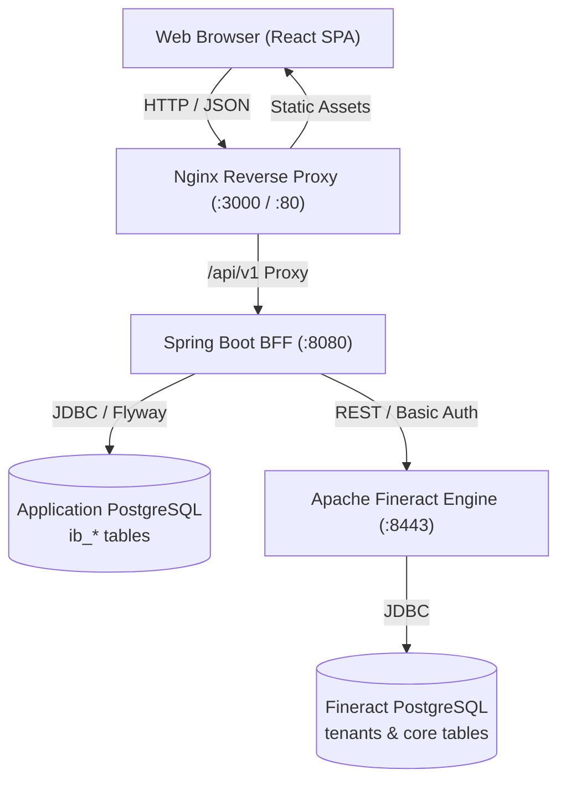

# Internet Banking Application – Comprehensive Setup & Deployment Guide

> **Demo & Prototype Notice**: This application operates with simulated money, dummy customers, and demo accounts on top of Apache Fineract. It does not connect to real-world payment rails (UPI, NEFT, RTGS, SWIFT, SEPA).

---

## Table of Contents
1. [Architecture Overview](#1-architecture-overview)
2. [Technology Stack](#2-technology-stack)
3. [User Personas & Demo Credentials](#3-user-personas--demo-credentials)
4. [Prerequisites](#4-prerequisites)
5. [Local Deployment via Docker Compose](#5-local-deployment-via-docker-compose)
6. [Standalone Local Development](#6-standalone-local-development)
7. [Deploying Frontend to Vercel](#7-deploying-frontend-to-vercel)
8. [Banking Security & Business Rules](#8-banking-security--business-rules)
9. [REST API Reference & cURL Examples](#9-rest-api-reference--curl-examples)
10. [Troubleshooting & FAQ](#10-troubleshooting--faq)

---

## 1. Architecture Overview

The system uses a **Backend-For-Frontend (BFF)** pattern. The React single-page application (SPA) communicates only with our Spring Boot BFF via `/api/v1`, never directly with Apache Fineract or database servers.



### Database Ownership Separation
* **Application DB (`ib_app`)**: Owns authentication mappings, role-permission matrix, user profiles, beneficiary books, idempotency keys, transfer workflow requests, maker-checker approval records, system limits, and audit logs.
* **Fineract DB (`fineract_tenants` / `fineract_default`)**: Owns the financial ledger, savings products, client profiles, savings accounts, double-entry ledger transactions, deposits, and transfers.
* **Invariant**: The application database never duplicates financial account balances or modifies Fineract tables directly.

---

## 2. Technology Stack

| Component | Technology | Responsibility |
|---|---|---|
| **Frontend** | React 18 + TypeScript + Vite | Internet Banking web portal |
| **UI Framework** | Material UI (MUI v6) | Responsive, modern banking layout |
| **Backend BFF** | Java 17/21 + Spring Boot 3.4 | Authentication, RBAC, limits, maker-checker workflows |
| **Core Banking** | Apache Fineract 1.12 | Savings accounts, double-entry ledger, transfers |
| **Databases** | PostgreSQL 16 (2 separate instances) | Isolated persistence for app & Fineract |
| **Proxy / Web Server** | Nginx Alpine | Routing, static hosting, reverse proxy, security headers |
| **Containerization** | Docker Compose | One-command local orchestration |
| **Cloud Hosting** | Vercel | Global edge CDN hosting for the React frontend |

---

## 3. User Personas & Demo Credentials

When demo data seeding is enabled (`APP_SEED_DEMO_USERS=true`), the following test accounts are pre-configured:

| Role | Username | Password | Default Landing Page | Primary Features |
|---|---|---|---|---|
| **Banking Customer** | `customer.alex` | `DemoPass@2026` | `/customer` | Balances, accounts, transfers, beneficiaries, statements |
| **Bank User (Staff)** | `bank.user1` | `DemoPass@2026` | `/staff` | Onboarding, demo accounts, maker-checker approvals |
| **Administrator** | `admin` | `CHANGE-ME-Admin#2026` | `/admin` | User CRUD, role matrix, transaction limits, audit, reports |

> **Tip**: The portal includes an instant **1-Click Demo Login** bar on `/login` and a **Quick Role Switcher** dropdown in the top header, making evaluation effortless.

---

## 4. Prerequisites

* **Docker Desktop** (version 24+ with Compose v2)
* **Node.js** (v18, v20, or v22 LTS) & **npm** (v9+)
* **Java Development Kit (JDK 17 or 21)** *(optional, only if compiling Spring Boot outside Docker)*
* **Git** command line

---

## 5. Local Deployment via Docker Compose

### Step 1: Clone Repository & Create `.env`
```bash
git clone https://github.com/your-org/internet-banking-mvp.git
cd internet-banking-mvp

cp .env.example .env
```

Ensure `.env` contains:
```env
POSTGRES_APP_PASSWORD=demo_app_secret
POSTGRES_FINERACT_PASSWORD=demo_fineract_secret
APP_BOOTSTRAP_ADMIN_PASSWORD=CHANGE-ME-Admin#2026
APP_SEED_DEMO_USERS=true
DEMO_USER_PASSWORD=DemoPass@2026
```

### Step 2: Launch Stack
```bash
docker compose up --build -d
```

### Step 3: Check Startup Progress
Apache Fineract initializes tenants and Flyway schemas on its first run (takes 2–3 minutes):
```bash
docker compose logs -f fineract
```
When Fineract logs `Started FineractApplication`, the banking engine is ready.

### Step 4: Open Web Portal
Navigate to:
```
http://localhost:3000
```
Sign in as `customer.alex`, `bank.user1`, or `admin`.

---

## 6. Standalone Local Development

If developing the frontend or backend independently:

### A. Run Frontend (Vite)
```bash
cd frontend
npm install
npm run dev
```
* Portal URL: `http://localhost:3000`
* By default, Vite proxies `/api` calls to `http://localhost:8080`.
* If no backend is running, the frontend automatically falls back to **Interactive Demo Mode** (in-memory mock store) so you can still test the entire UI!

### B. Run Spring Boot Backend
```bash
cd backend
# Run PostgreSQL container for the app database:
docker run --name local-app-db -e POSTGRES_DB=ib_app -e POSTGRES_USER=ib_app -e POSTGRES_PASSWORD=change_me_app -p 5433:5432 -d postgres:16-alpine

# Run Spring Boot (requires Maven or Docker build)
mvn spring-boot:run
```

---

## 7. Deploying Frontend to Vercel

The frontend is fully configured with `vercel.json` supporting SPA routing, gzip/brotli compression, and security headers.

### Option 1: 1-Click Deployment via Vercel CLI

1. Install or run Vercel CLI:
```bash
cd frontend
npx vercel
```
2. Follow the interactive prompts:
   * **Set up and deploy?**: `y`
   * **Which scope?**: Select your Vercel account
   * **Link to existing project?**: `N`
   * **Project name**: `openbank-portal` (or your preferred name)
   * **In which directory is your code located?**: `./`
   * **Want to modify build settings?**: `N` (Vite preset is auto-detected)
3. Deploy to production:
```bash
npx vercel --prod
```

### Option 2: Deploying via Vercel Web Dashboard (Git Integration)

1. Push your repository to GitHub / GitLab / Bitbucket.
2. Go to [https://vercel.com/new](https://vercel.com/new).
3. Import your repository.
4. Set **Root Directory** to `frontend`.
5. Build and Output settings are auto-configured by `vercel.json`:
   * **Build Command**: `npm run build`
   * **Output Directory**: `dist`
   * **Install Command**: `npm install`
6. Click **Deploy**.

### Environment Variables on Vercel:
| Variable | Value | Description |
|---|---|---|
| `VITE_DEMO_MODE` | `true` *(default on Vercel)* | Enables interactive mock store with zero backend dependency |
| `VITE_API_URL` | `https://your-backend.railway.app/api/v1` | *(Optional)* Point to live deployed Spring Boot BFF |

---

## 8. Banking Security & Business Rules

### 1. Maker-Checker Dual Authorization
* **Policy Threshold**: Any fund transfer exceeding the configured approval limit (default: **₹25,000.00**) is not processed immediately.
* It is recorded with status `PENDING_APPROVAL` in `ib_transfer_requests` and an entry is routed to `ib_approvals`.
* A **Bank User** must review and approve or reject the request.
* **Anti-Self-Approval**: An authorized staff member cannot approve a transfer if they are the initiator (`initiated_by == approved_by` is rejected by DB constraint and server code).

### 2. Idempotency Keys
* Every transfer submission accepts an `Idempotency-Key` HTTP header (UUID/v4).
* If network retries resubmit the same key, the server returns the cached transfer status without performing duplicate debits.

### 3. Double-Entry Core Ledger Integrity
* Fund transfers trigger reciprocal debit and credit entries with running balances stored in Apache Fineract.
* Overdraft protection prevents source accounts from going negative.

### 4. Session & Cookie Security
* Session identification uses an `HttpOnly` cookie (`IBSESSION`). JavaScript cannot read session tokens.
* CSRF protection uses Spring Security double-submit cookies with `SameSite=Lax`.

---

## 9. REST API Reference & cURL Examples

All application APIs are prefixed with `/api/v1`.

### 5.1 Authentication
```bash
# Login
curl -X POST http://localhost:3000/api/v1/auth/login \
  -H "Content-Type: application/json" \
  -d '{"username":"customer.alex","password":"DemoPass@2026"}' \
  -c cookies.txt

# Session Profile
curl -X GET http://localhost:3000/api/v1/auth/me -b cookies.txt
```

### 5.2 Customer Accounts & Statements
```bash
# List Linked Accounts
curl -X GET http://localhost:3000/api/v1/customer/accounts -b cookies.txt

# Account Balance Enquiry
curl -X GET http://localhost:3000/api/v1/customer/accounts/10001/balance -b cookies.txt

# Transaction Ledger
curl -X GET http://localhost:3000/api/v1/customer/accounts/10001/transactions -b cookies.txt
```

### 5.3 Fund Transfers
```bash
# Submit Transfer with Idempotency Key
curl -X POST http://localhost:3000/api/v1/transfers \
  -b cookies.txt \
  -H "Content-Type: application/json" \
  -H "Idempotency-Key: 550e8400-e29b-41d4-a716-446655440000" \
  -d '{
    "fromAccountId": 10001,
    "toAccountId": 10003,
    "amount": 5000.00,
    "currency": "INR",
    "remarks": "Dinner invoice reimbursement"
  }'
```

### 5.4 Bank User Operations
```bash
# Register New Customer (Staff)
curl -X POST http://localhost:3000/api/v1/staff/customers \
  -b cookies.txt \
  -H "Content-Type: application/json" \
  -d '{
    "username": "rohit.sharma",
    "fullName": "Rohit Sharma",
    "email": "rohit@example.com",
    "phone": "+91 98111 22334",
    "initialDeposit": 50000
  }'

# Review Pending Approvals
curl -X GET http://localhost:3000/api/v1/staff/approvals -b cookies.txt

# Authorize Transfer (Maker-Checker)
curl -X POST http://localhost:3000/api/v1/staff/approvals/1/approve \
  -b cookies.txt \
  -H "Content-Type: application/json" \
  -d '{"comment":"KYC and invoice documentation verified"}'
```

### 5.5 Administration & Limits
```bash
# Get Transaction Limits
curl -X GET http://localhost:3000/api/v1/admin/limits -b cookies.txt

# Update Maker-Checker Threshold
curl -X PUT http://localhost:3000/api/v1/admin/limits \
  -b cookies.txt \
  -H "Content-Type: application/json" \
  -d '{"code":"APPROVAL_THRESHOLD","value":30000}'

# System-Wide Transaction Reports
curl -X GET http://localhost:3000/api/v1/admin/reports/transactions -b cookies.txt
```

---

## 10. Troubleshooting & FAQ

### Q1: The Docker stack started, but `/fineract/status` shows "DOWN"?
Apache Fineract takes 2 to 3 minutes to run its internal database migration routines on initial boot. Check the Fineract logs:
```bash
docker compose logs -f fineract
```
Once `Started FineractApplication` appears, the status will turn to `UP / OK`.

### Q2: What happens if I deploy only the frontend to Vercel?
The frontend automatically runs in **Live Demo Sandbox Mode**. All three personas (`customer.alex`, `bank.user1`, `admin`), account balances, beneficiaries, maker-checker approvals, and reports are fully functional and interactive in the browser.

### Q3: How do I connect the Vercel frontend to a production backend?
Deploy the Spring Boot backend container to a cloud container host (e.g., Render, Railway, AWS ECS, or Fly.io), then set the environment variable `VITE_API_URL=https://your-api-domain.com/api/v1` in your Vercel project settings.
